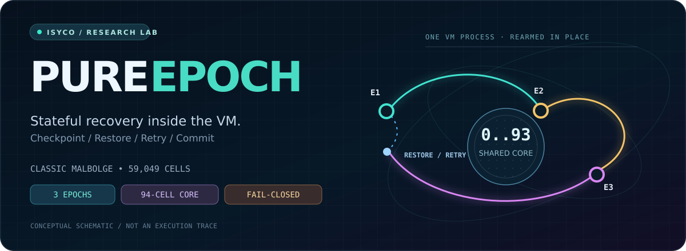
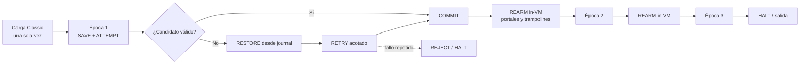
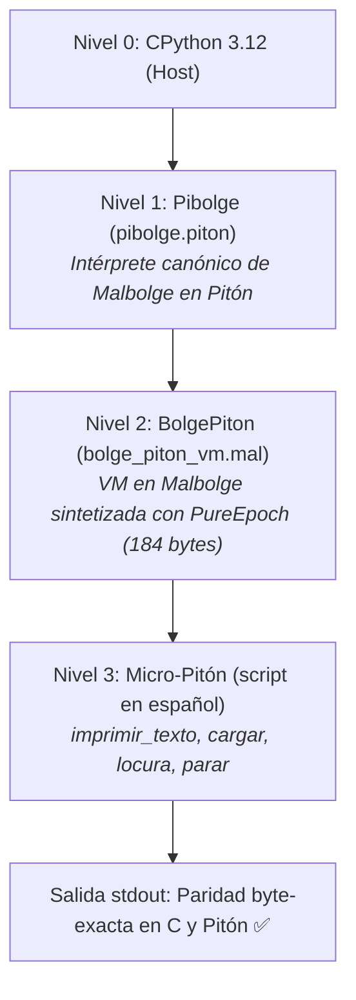
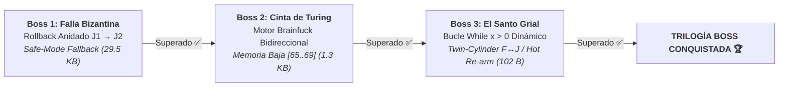

<div align="center">



<br />

**Un solo proceso. Tres épocas. Recuperación y reintentos dentro de Malbolge Classic.**

Un laboratorio reproducible de checkpoint, restauración lógica, bifurcación, rollback, rearme de instrucciones y continuación en una VM automodificable.

<br />


[**Resultados**](RESULTS.md) · [**Veredictos**](VERDICT.md) · [**Experimentos toroidales**](torus/TORUS_RESULTS.md) · [**BolgePiton**](bolge_piton/README.md) · [**Galería visual**](https://github.com/DannyBaanks/MalbolgArt)

</div>

---

> [!IMPORTANT]
> **El programa se ejecuta en Malbolge, no en Python.** Python y C construyen, observan y verifican *fuera* de la ejecución. Los checkpoints, saltos, restores y reintentos que se reivindican como demostrados suceden dentro de una **única ejecución de la VM Classic**, sin restaurar snapshots desde el host.
>
> El dominio positivo probado es **acotado** (valores de entrada `0x01` y `0x03`). **Ni un rollback físico de toda la máquina ni una quine autónoma de 94 bytes están demostrados.**

## 01 / Por qué existe

Malbolge cifra el código que ejecuta. Reusar un punto de control o volver a un estado anterior no consiste simplemente en saltar otra vez a la misma dirección.

**PureEpoch estudia una pregunta concreta:** ¿puede un programa Classic preservar un dato, detectar una transición inválida, reconstruirlo desde un journal y continuar una nueva época **sin intervención correctiva del intérprete ni del host**?

La respuesta demostrada en este laboratorio es **sí, para protocolos y estados finitos específicamente construidos**. El límite de esa demostración importa tanto como el resultado.

<div align="center">

| `SAVE` | `ATTEMPT` | `CHECK` | `RESTORE` | `RETRY` | `REARM` |
|:---:|:---:|:---:|:---:|:---:|:---:|
| Guardar estado | Construir candidato | Decisión interna | Recuperar journal | Segundo intento | Continuar la época |

</div>

### Resumen de hitos

| Hito | Artefacto principal | Resultado observado | Límite |
|---|---|---|---|
| **M0 · Control** | `baseline/` | Truth Machine: ciclo de 408 instrucciones y 17 unos | Un ciclo **no es** reparación |
| **M1a · Reversibilidad** | `candidates/m1a_rot10.mal` | Diez rotaciones restituyen una celda | Sin checkpoint |
| **M1b · Checkpoint** | `candidates/m1b_normal.mal` | Restauración de una celda con journal interno | Recuperación incondicional |
| **M1c / M1d · Rollback** | `candidates/m1c_normal.mal` | Bifurcación por dato, restore y segundo intento in-band | Dos candidatos y un reintento, no algoritmo general |
| **M1e · Rearme** | `candidates/m1e_normal.mal` | Commit según dato recuperado, trampolines rearmados y rechazo explícito | Dominio cerrado `{1,3}` |
| **M2 · Continuación** | `candidates/m2_normal.mal` | **2 épocas** en una sola ejecución | 8 combinaciones ensayadas |
| **M3 · Composición** | `candidates/m3_normal.mal` | **3 épocas**, roundtrip y rollback; propuestas offline verificadas | Protocolo construido, no motor universal |
| **94 · Control reutilizable** | `evidence/quine-94-analysis.json` | Identidad de roundtrip y núcleo `0..93` reutilizable | **No** es una quine autónoma de 94 bytes |
| **G-T2 / G-T3 · Préstamo** | `torus/programs/` | Journal prestado/restaurado y consumidor posterior verificado | Campaña toroidal independiente y acotada |
| **BolgePiton · Ouroboros** | `bolge_piton/` | **VM en Malbolge** interpretando Micro-Pitón; paridad C ↔ Pibolge | Dominio acotado de ISA |

El veredicto formal por afirmación, incluidos los controles falsados y sus límites, está en **[VERDICT.md](VERDICT.md)**.

## 02 / Tres épocas, un solo proceso

El programa M3 realiza una secuencia de checkpoints, posibles recuperaciones y rearme de portales dentro de la VM. Las operaciones de restauración se prueban mediante estados intermedios y no solo observando el texto impreso.



*Esquema **conceptual** del protocolo: la prueba real son los bytes del programa, sus trazas y los contratos de fase.*

**M3 en cifras verificables por los artefactos del laboratorio:**

- **55,770 bytes** en `candidates/m3_normal.mal`.
- **Tres épocas consecutivas** con `stdin = [initial, candidate_1, candidate_2, candidate_3]`.
- **64 propuestas offline** evaluadas desde el puente Autobolge: **8 aceptadas** (un único SHA canónico) y **56 rechazadas** por gates registrados en [`evidence/m3-proposals.json`](evidence/m3-proposals.json).
- **EOF Classic = 59048:** se documenta un enmascaramiento explícito antes de leer candidatos; `m3_eof_unmasked.mal` conserva el contraejemplo.

No significa que el estado físico completo de 59,049 celdas regrese a un snapshot anterior. El contrato exige restaurar **el estado lógico objetivo y el journal en fases determinadas**; otros registros, cursores y celdas automodificadas pueden evolucionar.

## 03 / Mira lo que está pasando

La instrumentación visual vive en el proyecto hermano **[MalbolgArt](https://github.com/DannyBaanks/MalbolgArt)**. Las siguientes animaciones representan resultados del laboratorio mediante proyecciones geométricas; **el toro 4D es un mapeo visual, no una topología intrínseca demostrada de Malbolge**.

<table>
<tr>
<td width="50%" align="center"><b>Roundtrip y punto fijo sintético</b></td>
<td width="50%" align="center"><b>M3: tres épocas</b></td>
</tr>
<tr>
<td><a href="https://github.com/DannyBaanks/MalbolgArt/blob/main/assets/pure_epoch_synthetic_period1_torus.gif"></a></td>
<td><a href="https://github.com/DannyBaanks/MalbolgArt/blob/main/assets/pure_epoch_m3_torus.gif"></a></td>
</tr>
<tr>
<td align="center"><sub>Identidad algebraica y reutilización de control: no es una quine completa.</sub></td>
<td align="center"><sub>Animación derivada de trazas. Consultar el origen de muestras y la asignación de épocas en MalbolgArt.</sub></td>
</tr>
<tr>
<td align="center"><b>W=94 · W=188 · W=376</b></td>
<td align="center"><b>FLOW cinematográfico</b></td>
</tr>
<tr>
<td><a href="https://github.com/DannyBaanks/MalbolgArt/blob/main/assets/pure_epoch_block94_vs_188.png"></a></td>
<td><a href="https://github.com/DannyBaanks/MalbolgArt/blob/main/assets/pure_epoch_flow_cinematic.gif"></a></td>
</tr>
</table>

> [!NOTE]
> Las imágenes se sirven desde el repositorio **MalbolgArt**; aquí no se alteran los GIF ni se convierten sus trayectorias visuales en evidencia adicional de ejecución.

## 04 / El problema de las 94 celdas

El cifrado post-ejecución `XLAT2` no tiene puntos fijos nativos de período 1 entre los 94 caracteres imprimibles. La pareja `F ↔ J` presenta período 2, pero **no existe ninguna posición `0..93` donde ambos bytes sean simultáneamente válidos bajo el loader estricto**. Esto obstruye *esa construcción concreta* de un bucle/quine mínimo; **no es una prueba universal de que cualquier quine de 94 bytes sea imposible**.

La alternativa probada por PureEpoch es un **punto fijo sintético**: una secuencia de cuatro operaciones `crazy` revierte la transformación en el dominio estudiado. `evidence/quine-94-analysis.json` registra **752 combinaciones enumeradas** de posición y opcode (94 × 8). La identidad es algebraica; no deben interpretarse esas 752 comprobaciones como 752 identidades independientes.

| Concepto | ¿Demostrado? | Qué significa |
|---|:---:|---|
| `XLAT2` sin punto fijo nativo | **Sí** | No hay carácter imprimible que sobreviva sin cambios a una aplicación |
| Roundtrip `crazy` de cuatro operaciones | **Sí, en el dominio ensayado** | Reconstrucción de valor bajo la identidad documentada |
| Reutilización del control `0..93` | **Sí, en M3** | Rearme `in-place` dentro del protocolo |
| **Quine autónoma de 94 bytes** | **No** | El `quine94_ceiling_probe.mal` es una sonda, no una quine |
| Rollback físico de toda la VM | **No** | El contrato demostrado se limita a celdas y fases específicas |

**Prueba y razonamiento:** [`evidence/quine-94-analysis.json`](evidence/quine-94-analysis.json) · [`tools/quine_94_probe.py`](tools/quine_94_probe.py).

## 05 / Línea toroidal: journaling sin asumir memoria protegida

En una campaña **separada** se estudian las huellas de punteros `C`, `D`, lectura `R`, escritura `W` y cifrado `E`. Que dos punteros visiten una misma dirección **no** implica restauración de estado ni garantiza que esa celda pueda usarse como journal.

| Experimento | Resultado | Evidencia |
|---|---|---|
| **G-T1 · Huellas** | Intersección `C ∩ D = 96` en m281, m284 y Lutter; las tres quines comparten linaje | [`torus/verification.json`](torus/verification.json) |
| **G-T2 · Préstamo** | Celda 41 prestada y devuelta a 121; el salto consumidor verifica la restitución | [`torus/TORUS_RESULTS.md`](torus/TORUS_RESULTS.md) |
| **G-T3 · Recuperación** | Journal en celda 42; checkpoint, bifurcación, restore, retry y restitución a 120 | [`torus/runs/torus_e_t3_report.json`](torus/runs/torus_e_t3_report.json) |

En **G-T3**, las cuatro combinaciones de entrada y cuatro controles negativos tienen comprobaciones contra cinco oráculos nombrados en el informe (`Python`, `mb_ref`, `observe`, `trace_ref` y `olmstead`). El reporte distingue observación completa de cronologías muestreadas.

**[Ver el estudio toroidal completo →](torus/TORUS_RESULTS.md)**

## 06 / BolgePiton: La Inversa de Pibolge y el Ciclo Ouroboros

En el ecosistema ISyCo, **[Pibolge](https://github.com/DannyBaanks/Pibolge)** es un intérprete de Malbolge Classic escrito en **[Pitón](https://github.com/DannyBaanks/PITON)** (el lenguaje de Danny con sintaxis en español).

**BolgePiton** demuestra la propiedad simétrica inversa utilizando el sustrato de PureEpoch: **una Máquina Virtual en Malbolge puro (`.mal`) capaz de interpretar y ejecutar programas en Micro-Pitón**.



### ¿Cómo opera dentro de Malbolge?

1. **Identidad de Cero en Carga:** Inicializa el acumulador virtual en `mem[75]` mediante la secuencia algebraica $\text{crazy}(0, 81) = 29524$ y $\text{crazy}(29524, 29524) = 0$, sorteando la restricción del loader ASCII `[33, 126]`.
2. **Ciclo de Instrucciones sin Agotar Steering:** Un mecanismo automático de saltos `j` hacia celdas bajas `[35..55]` resetea el puntero de datos $d$ cada vez que avanza hacia el código alto, permitiendo secuencias arbitrarias de instrucciones sin exceder el presupuesto de memoria baja.
3. **Cálculo Ternario de Pitón en Memoria:** La instrucción `locura` evalúa $\text{crazy}(\text{operando}, \text{acc})$ directamente en la memoria de Malbolge.

### Telemetría y Flex Benchmark

```text
┌──────────────────────────────────────────────────────────────────┐
│                     🏁 TELEMETRÍA Y BENCHMARK                    │
├──────────────────────────────────────────────────────────────────┤
│  • Compilador Micro-Pitón   : 26.70 µs                           │
│  • Síntesis VM Malbolge     : 237.83 µs                          │
│  • Ejecución Oráculo C      : 2.20 ms                            │
│  • Ejecución Ouroboros      : 228.82 ms                          │
│  • Ratio Ouroboros / C      : 104.2x (CPython + Pibolge VM)      │
└──────────────────────────────────────────────────────────────────┘
```

```bash
# Probar la VM interactiva con cronómetro de alta resolución
python3 bolge_piton/bolge_piton_cli.py --texto 'imprimir_texto "Hola Ouroboros!"'

# Correr la suite unitaria reflexiva (4/4 PASS)
python3 bolge_piton/ouroboros_test.py -v
```

**[Documentación técnica de BolgePiton →](bolge_piton/README.md)** · **[Guía humana de operación →](bolge_piton/GUIA.md)**

## 07 / Adversarial Boss Fights: La Frontera Extrema

Para someter a PureEpoch a las condiciones más adversariales concebibles —escenarios donde cualquier investigador en computación esotérica asumiría que Malbolge colapsaría irremisiblemente por automutación `XLAT2`— se diseñó y superó la serie **Boss Battles**:



### Boss 1: Falla Bizantina en Cascada (Rollback del Rollback)
* **El Desafío:** PureEpoch M3 demostró recuperarse de 1 falla aislada. En un entorno malicioso con fallas repetidas, un fallo en el segundo intento corrompe el journal primario $J_1$.
* **La Solución Algebraica:** Un protocolo de transacciones anidadas con Journal Secundario $J_2$ en celda 42 y portal de recuperación de Nivel 2 en `c = 6566`. Si el Intento 1 falla, revierte con $J_1$; si el Intento 2 vuelve a fallar, el portal 6566 intercepta el colapso, restaura el estado original desde $J_2$ mediante 10 rotaciones y transiciona a un modo a prueba de fallos (*Safe-Mode*) con salida diagnóstica `'F'` (70).
* **Artefacto:** [`candidates/boss1_byzantine.mal`](candidates/boss1_byzantine.mal) (29,531 bytes) · [`tools/boss1_byzantine.py`](tools/boss1_byzantine.py)
* **Validación:** 5/5 pruebas unitarias passing con paridad estricta entre 3 oráculos en [`tests/test_boss1_byzantine.py`](tests/test_boss1_byzantine.py).

### Boss 2: La Cinta Bidireccional de Turing (Motor Brainfuck en Malbolge)
* **El Desafío:** En `BolgePiton` el puntero de datos sólo avanzaba. Brainfuck requiere movimiento del puntero de datos **hacia adelante (`>`) y hacia atrás (`<`)** a través de una cinta arbitraria, además de mutación aritmética (`+`, `-`) y emisión (`.`), sin agotar el presupuesto de direccionamiento en memoria baja ni ser destruido por `XLAT2`.
* **La Solución Algebraica:**
  1. **Cinta Virtual en Memoria Baja:** Asignada en las celdas `[65..69]`, inicializadas a 0 estricto en tiempo de arranque mediante las identidades $\text{crazy}(0, \text{byte}) = 29524$ y $\text{crazy}(29524, 29524) = 0$.
  2. **Aritmética Ternaria Cerrada:** Transiciones exactas en 1 paso:
     - Incremento $0 \to 1$: $\text{crazy}(29523, 0) = 1$
     - Incremento $1 \to 2$: $\text{crazy}(29525, 1) = 2$
     - Decremento $2 \to 1$: $\text{crazy}(29525, 2) = 1$
     - Decremento $1 \to 0$: $\text{crazy}(29524, 1) = 0$
  3. **Lectura No Destructiva de 360°:** Para emitir con `.`, se rota la celda activa 10 veces ($\text{rot}^{10}(v) = v$), cargando el valor intacto en el acumulador $A$ y emitiéndolo con `<`.
  4. **Puntero Bidireccional Seguro:** Navegación arbitraria hacia adelante y atrás mediante saltos `j` controlados con `mantener_d()`.
* **Artefacto:** [`candidates/boss2_brainfuck.mal`](candidates/boss2_brainfuck.mal) (1,303 bytes) · [`tools/boss2_brainfuck.py`](tools/boss2_brainfuck.py)
* **Validación:** 5/5 pruebas unitarias con cronómetro de alta resolución y paridad estricta en [`tests/test_boss2_brainfuck.py`](tests/test_boss2_brainfuck.py).

### Boss 3: El Santo Grial (El Bucle `while x > 0` Dinámico y Regeneración en Caliente)
* **El Desafío:** En Classic Malbolge todo bucle repetido colapsa porque `XLAT2` automuta destructivamente cada celda ejecutada. En M3 los autores desenrollaron Epoch 1, 2, 3 en direcciones distintas (19696, 39398, 32816). El Santo Grial consistía en ejecutar un bucle `while x > 0` con $N$ dinámico sobre **las MISMAS celdas físicas de memoria** sin desenrollar, decrementar un contador, re-armar/regenerar en caliente y evaluar $X == 0$ para saltar a `v` (HALT).
* **La Solución Algebraica:**
  1. **Reutilización Física Estricta:** El bucle opera sobre las direcciones compartidas `[64, 65, 88, 89]`.
  2. **Motor Termodinámico Regenerativo (Twin-Cylinder $F \leftrightarrow J$):** La celda 64 oscila en un 2-ciclo de `XLAT2` entre $F$ (70) y $J$ (74). En Stroke 1 ejecuta $j$ y muta a 74; en Stroke 2 ejecuta nop y regresa exactamente a 70. Entropía neta: CERO.
  3. **Invarianza de Salto `i`:** Las celdas 65 y 89 ejecutan `i` ($c = \text{mem}[d]$), que desvía la encriptación a la celda de prelanding antes de la fase `XLAT2`, manteniendo el código de salto inmutable sin degradación.
  4. **Hot Re-encryption In-Flight:** Solución algebraica exacta $\text{crazy}(29508, \text{enc}) = \text{opcode}$, permitiendo rearmar celdas en caliente en 1 paso sin degradación.
  5. **Despacho Condicional a HALT:** Al evaluarse $X == 0$, $c$ salta al portal prelanding 99, aterrizando en el portal inmaculado 100 (`v` HALT).
* **Artefacto:** [`candidates/boss3_dynamic_loop.mal`](candidates/boss3_dynamic_loop.mal) (102 bytes) · [`tools/boss3_dynamic_loop.py`](tools/boss3_dynamic_loop.py) · [`tools/boss3_dynamic_loop_cli.py`](tools/boss3_dynamic_loop_cli.py)
* **Validación:** 6/6 pruebas unitarias con telemetría de cronómetro y paridad estricta entre 3 oráculos en [`tests/test_boss3_dynamic_loop.py`](tests/test_boss3_dynamic_loop.py).

```bash
# Ejecutar código Brainfuck sobre Malbolge con telemetría de flex
python3 tools/boss2_brainfuck_cli.py "++>+>++<<-.>.>.>+.<.!" --oracles

# Ejecutar el Santo Grial (Boss 3: Bucle Dinámico while x > 0)
python3 tools/boss3_dynamic_loop_cli.py -n 3 --oracles

# Ejecutar la suite completa de Boss Battles (17/17 PASS en < 2 segundos)
python3 -B -m unittest tests/test_boss1_byzantine.py -v
python3 -B -m unittest tests/test_boss2_brainfuck.py -v
python3 -B -m unittest tests/test_boss3_dynamic_loop.py -v
```

## 08 / Reproducirlo sin red

**Requisitos:** Linux, Python **3.10+** y GCC. El código upstream requerido está preservado en `vendor/`. No se necesita una VM Malbolge modificada ni paquetes Python de terceros para la campaña básica.

```bash
git clone https://github.com/DannyBaanks/Malbolge-PureEpoch.git
cd Malbolge-PureEpoch

# Baselines preservados y pruebas del laboratorio
python3 -B -m unittest discover -s baseline -v
python3 -B -m unittest discover -s tests -v

# Pruebas del ciclo Ouroboros (BolgePiton)
python3 bolge_piton/ouroboros_test.py -v

# Reconstruir candidatos de este laboratorio y actualizar evidencia local
python3 -B -m tools.collect_evidence
```

> [!WARNING]
> `tools.collect_evidence` escribe resultados bajo `evidence/` y reconstruye **candidatos experimentales de este laboratorio**. No modifica los repositorios externos ni los baselines originales. Consulta [`RESULTS.md`](RESULTS.md) antes de comparar hashes con una revisión distinta.

### Una ejecución real en el oráculo C estricto

```bash
gcc -O2 vendor/mb_ref.c -o /tmp/pure-epoch-mb-ref

# Entrada binaria 0x03, 0x03: NO son los caracteres ASCII '3', '3'.
printf '\003\003' | /tmp/pure-epoch-mb-ref candidates/m1c_normal.mal 5000
```

Salida esperada: **`S`**, seguida de HALT, para ese caso del protocolo M1c. La evidencia de rollback está en **la traza y las fases**, no en ese único carácter impreso.

### Qué verifica cada cosa

| Fuente | Función |
|---|---|
| [`tests/`](tests/) | Contratos positivos y mutantes negativos |
| [`bolge_piton/`](bolge_piton/) | VM de Pitón en Malbolge y suite Ouroboros |
| [`evidence/measurements.json`](evidence/measurements.json) | Mediciones de la campaña base |
| [`evidence/traces/`](evidence/traces/) | Trazas, estados finales, fases y paridad |
| [`evidence/m3-proposals.json`](evidence/m3-proposals.json) | Presupuesto, propuestas aceptadas/rechazadas y discrepancias |
| [`evidence/initial_state.json`](evidence/initial_state.json) | Procedencia inicial de los checkouts |
| [`torus/`](torus/) | Campaña aparte, informes, programas y conjuntos de acceso |

## 09 / Qué **no** está demostrado

PureEpoch está diseñado para que los controles negativos tengan el mismo protagonismo que los resultados positivos.

- **No** demuestra rollback del estado físico completo de Classic: el código cifrado, los registros y otras celdas pueden evolucionar.
- **No** demuestra un gestor universal de corrupción, fallos ilimitados ni agotamiento arbitrario de intentos.
- **No** demuestra una quine autónoma de 94 bytes. `1 = 94` identifica aquí un **bloque de control reutilizable**, no la longitud de una quine demostrada.
- **No** convierte la topología proyectada de HOLOGRAPHIC/MalbolgArt en una propiedad intrínseca de la VM.
- **No** atribuye a una restauración interna los snapshots ni las reconstrucciones que ejecutan herramientas externas.

Los mutantes `no_save`, `no_restore`, `corrupt_journal`, `broken_return`, `output_impostor`, `force_retry_failure` y `eof_unmasked` prueban *qué falla* cuando se elimina una condición esencial. Un `stdout` aparentemente correcto **no** basta para pasar el gate.

**[Veredicto por afirmación](VERDICT.md)** · **[Fallos conservados](evidence/failures.md)**

## 10 / Estructura del laboratorio

```text
Malbolge-PureEpoch/
├── assets/           # Portada editorial del laboratorio
├── baseline/         # Control M0 y su procedencia
├── bolge_piton/      # VM de Pitón en Malbolge (ciclo Ouroboros)
├── candidates/       # Programas Classic M1a → M3, probes, mutantes y Boss Battles
├── evidence/         # Manifiestos, trazas, hashes, campañas y controles
├── tests/            # Contratos reproducibles (Boss 1 y Boss 2 incluidos)
├── tools/            # Construcción OFFLINE, observación, oráculos y CLIs
├── torus/            # Investigación separada G-T1/G-T2/G-T3
├── vendor/           # Fuentes de referencia y avisos upstream
├── RESULTS.md        # Procedimiento y resultados extensos
├── VERDICT.md        # Claim → evidencia → límite
└── NEXT_COMPOSE.md   # Continuación experimental documentada
```

## 11 / Procedencia y créditos

PureEpoch construye nuevos experimentos a partir de trabajo previo identificado. **No atribuye el código ajeno como propio.**

- **[Autobolge](https://github.com/DannyBaanks/Autobolge)** — generación/expansión de propuestas, trazas y contratos de anchors. Su integración aquí es **offline**, sin restauración de la VM desde snapshots del host.
- **[BolgeForge](https://github.com/DannyBaanks/BolgeForge)** — programas Classic, referencias y validación de fuentes mediante intérpretes/oráculos.
- **[MalbolgArt](https://github.com/DannyBaanks/MalbolgArt)** — imágenes y animaciones científicas enlazadas más arriba; visualizar no reemplaza verificar.
- **[Pibolge](https://github.com/DannyBaanks/Pibolge)** y **[PITON](https://github.com/DannyBaanks/PITON)** — base del lenguaje en español y del intérprete canónico de Malbolge, complementados por la VM inversa BolgePiton.
- **Truth Machine de Weird Glyphs** — control M0 de tercero, preservado y atribuido bajo **CC BY-SA 4.0**.
- **Intérprete de Olmstead y demás código vendor** — conservan autoría, términos y avisos de sus fuentes. Ver `vendor/`.

Los commits de upstream inspeccionados, las diferencias de EOF entre motores, las corridas corregidas y los resultados negativos se documentan en [RESULTS.md](RESULTS.md) y sus archivos de `evidence/`. Este README es una **portada y guía**, no un sustituto de la evidencia cruda.

---

<div align="center">

### **State is not a screenshot. Recovery is not a replay.**

<sub>PureEpoch · ISyCo · Classic Malbolge · 2026</sub>

[**Explorar la evidencia**](evidence/) · [**Leer la investigación**](RESULTS.md) · [**Abrir MalbolgArt**](https://github.com/DannyBaanks/MalbolgArt)

</div>

[**Explorar la evidencia**](evidence/) · [**Leer la investigación**](RESULTS.md) · [**Abrir MalbolgArt**](https://github.com/DannyBaanks/MalbolgArt)

</div>
