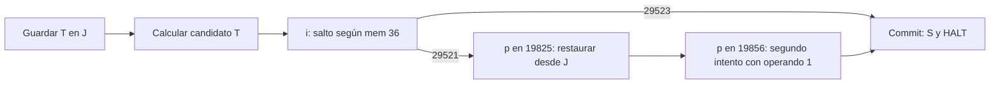

# Resultados — Pure Epoch M1

## Qué se construyó

Un programa Classic loader-valid de **29,526 bytes** (`candidates/m1c_normal.mal`) que preserva una celda lógica mediante otra celda in-band, calcula un candidato, bifurca según el valor real de la celda, recupera el valor guardado si falla y realiza un segundo intento corregido. Es un experimento finito: dos estados previos × dos operandos candidatos. No se reivindica primacía histórica, recuperación general, protección de memoria o rollback físico de la VM.

La construcción es independiente del código de la Truth Machine: utiliza identidades crazy/rotación y ensamblaje por dirección. M0 sigue siendo un control de ciclo distinto y atribuido a Weird Glyphs.

## M0 reproducido antes de modificar

Los siete archivos originales se leyeron y se ejecutaron 5 tests antes de crear este laboratorio. Una segunda reproducción de la copia preservada quedó en `evidence/m0-tests.txt` y `evidence/report-reproduced.json`. Coinciden hashes de los siete archivos y JSON completo con el baseline: ciclo de 408 instrucciones, 17 unos, cuatro celdas modificadas durante el ciclo; corrupción negativa persistente. Esto es **CYCLE**, no reparación.

## Contrato lógico y mecanismo

Memoria Classic de 59,049 celdas; fuente ASCII estricta; ocho opcodes originales. Target `T=36`, journal `J=52`, cero auxiliar `75`, generador del operando `81`, portal de recuperación `62`. No hay escritura desde el host ni reanudación de snapshots. Cada ejecución comienza en `(a,c,d)=(0,0,0)` con una sola carga del archivo.

Sea `U=29524` (diez trits 1). `crazy(x,U)` permuta los trits 0/1 y conserva 2; esa transformación es una involución. Para los selectores binarios en este dominio:

1. `p` prepara `J=U` y un cero auxiliar dentro de la VM.
2. El primer byte `s∈{1,3}` y una semilla 81 producen `T=U-s`.
3. `p` sobre J guarda `crazy(T,U)=s`, una representación interna reversible del valor previo.
4. Con el cero construido internamente, `p` convierte T en U. El segundo byte `x∈{1,3}` produce el candidato `T=U-x`.
5. `i` en `c=177`, `d=36`, usa **la celda calculada** como destino. T=29523 entra en commit `c=29524`; T=29521 entra en fallo `c=29522`. Es una tabla indirecta para este dominio finito, no un comparador de enteros arbitrarios.
6. La ruta de fallo repone U, lee J mediante diez rotaciones que también lo preservan y ejecuta `p` en `c=19825`: T vuelve a `U-s`.
7. Cuatro rotaciones de la semilla 81 construyen el operando 1. `p` en `c=19856` repite la transición con ese operando; el nuevo T=29523 toma commit. No se pide otro byte al host.

El único output se ejecuta en commit. La conservación del journal es parte del contrato; las lecturas por rotación lo mutan temporalmente y lo devuelven a su valor. No es memoria protegida.

## Casos positivos

| stdin hex | T previo | Ruta | Instrucciones incluyendo HALT | T final | J final | stdout |
|---|---:|---|---:|---:|---:|---|
| `0101` | 29523 | commit | 82 | 29523 | 1 | `53` (`S`) |
| `0103` | 29523 | recuperación → retry → commit | 249 | 29523 | 1 | `53` |
| `0301` | 29521 | commit | 82 | 29523 | 3 | `53` |
| `0303` | 29521 | recuperación → retry → commit | 249 | 29523 | 3 | `53` |

La salida constante no es la evidencia de recuperación. Se compara la fase de restore, el journal y la memoria completa entre implementaciones. En este juguete, el resultado final fijo también podría alcanzarse omitiendo restore: el control `no_restore` lo hace y **se rechaza** por incumplir la restauración intermedia. No se afirma que restaurar sea necesario para obtener ese byte; sí que el programa ejecuta la recuperación y que esa fase depende causalmente del valor guardado.

## Primer restore observado

Para `0303`, índice de traza **211** (instrucción ejecutada número **212**):

| Campo | Antes | Después |
|---|---|---|
| Opcode | `p`, residuo 62 | — |
| `(a,c,d,input_cursor)` | `(3,19825,36,2)` | `(29521,19826,37,2)` |
| `mem[36]` | 29524 | **29521** |
| `mem[52]` | 3 | 3 |
| Output emitido | ninguno | ninguno |

En el índice 242, `p` en `19856` cambia T de 29521 a 29523. Commit ocurre en el índice 247; HALT en 248. Véanse `evidence/traces/m1c_normal-0303/{trace.jsonl,python-trace.jsonl,phases.json,state.bin,parity.json}`. El estado final completo C/Python es idéntico.

## Positivos menores y controles

- M1a: `m1a_rot10.mal`, 98 bytes, diez rotaciones de `mem[96]`: 37→19695→…→37 y HALT en 43 instrucciones. Nueve rotaciones dejan 111. Es **REVERSIBLE**, sin journal ni decisión.
- M1b: `m1b_normal.mal`, 308 bytes, entradas `0100`/`0300`, devuelve 29523/29521 leyendo el journal; 210 instrucciones. Su output sí depende del valor recuperado (`S`/`Q`). Es **CHECKPOINT** con recuperación incondicional.
- `m1b_output_impostor`: imprime `S` pero deja T=9841. Gate de memoria lo rechaza.
- M1c `no_save`, `corrupt_journal`, `no_restore`: pueden imprimir `S` y dejar T final válido; el gate de fases/journal los rechaza. No se acepta output ni estado final solos como prueba del protocolo.
- M1c `no_recovery`, `broken_return`, `early_halt`: detienen sin completar recuperación/commit; se rechazan.
- `force_retry_failure`: cambia la construcción del operando corregido, vuelve a generar el candidato inválido y termina en **STALL**, tras 254 fetches. No hubo rescate externo. No existe un manejador autónomo demostrado para fallos repetidos ni agotamiento de intentos.
- Un límite de un paso queda BUDGET y no satisface el contrato; el límite es de observación/prueba, no recuperación.

Todos los `.mal` negativos quedan conservados y pasan el loader estricto; falla la propiedad que pretenden satisfacer. Ver `evidence/measurements.json` y `evidence/failures.md`.

## Oráculos y regresiones

La campaña contiene 19 ejecuciones pequeñas. El C instrumentado y Python coinciden en cada transición, todos los cambios de celda y la memoria final completa. El C estricto **sin cambios** reproduce stdout/stop; el intérprete original Olmstead sin cambios reproduce stdout/HALT de los 18 casos que terminan. El control STALL se compara entre los dos motores acotados; no se ejecuta el histórico sin límite en una condición donde se quedaría esperando.

Instrumentar observación no convierte al observador en restaurador. El C instrumentado usa la operación de la referencia base9; el observador M0 Python calcula por diez trits. Los procesos originales se ejecutan aparte. No se afirma que el histórico sin instrumentar exporte memoria final.

Autobolge: 15 tests pertinentes pasan en el clon fijado, tras compilar los dos probes necesarios. BolgeForge: `make test` pasa con 52 unit tests y sus controles de corpus/compresión/quines/espejo. Logs crudos conservados. El adaptador offline emplea el `char_for` real de Autobolge, reproduce los mismos bytes, exporta anchors **observados** después de restore y valida replay desde cero. No llama a `EpochAnchorV1.restore()` y no guía aún propuestas relacionales.

Una reproducción mínima expone la diferencia EOF: fuente de dos bytes `uP`, stdin vacío. Classic estricto alcanza HALT con a=59048; Autobolge se detiene en INPUT_UNDERFLOW con a=0. Resultado completo en `evidence/autobolge-bridge.json`. No se declara paridad global entre ambas semánticas.

## Addendum toroidal

`torus/` confirma C∩D=96 en m281/Lutter/m284. Las intersecciones se descomponen en 49 direcciones fijas y 47 reubicadas, consistente con la procedencia Lutter. No son tres diseños independientes. El script externo actual coincide con la medición C para m281; algunas cuentas de la captura anterior no se reprodujeron. Se conserva la discrepancia y la falsación del detector original de simetría.

La celda 53 es accesible y modificable, pero ya contiene estado vivo del loop: usarla como reserva intacta queda refutado. G-T3 del quine permanece NOT_DEMONSTRATED. El éxito M1 del programa pequeño no se transfiere a los quines.
