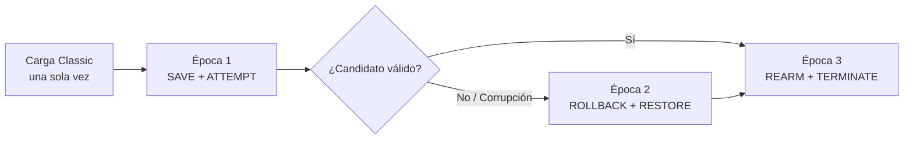
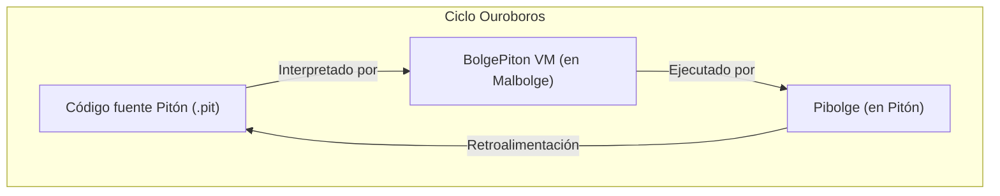

# Arquitectura Técnica de Malbolge-PureEpoch

Este documento detalla los fundamentos matemáticos, la estructura de journaling toroidal y la mecánica de ejecución multi-época dentro de la máquina virtual de **Classic Malbolge** (especificación Ben Olmstead, 1998).

---

## 1. El Problema de las 94 Celdas y la Cifra Post-Ejecución

En Malbolge Clásico, cada instrucción ejecutada se cifra inmediatamente mediante la función de sustitución `XLAT2`:

$$c' = \text{XLAT2}[(c - 33) \pmod{94}] + 33$$

Dicha permutación no posee ningún punto fijo de período 1 entre los 94 caracteres imprimibles ASCII (rango 33..126). 
Aunque existe la pareja de período 2:

$$F \longleftrightarrow J$$

**no existe ninguna posición $0 \le p < 94$ en la memoria donde ambos bytes sean simultáneamente válidos bajo el cargador estricto de Olmstead.** 

Esto obstruye la construcción trivial de un bucle o quine de 1 instrucción, forzando a que cualquier estructura de persistencia o repetición requiera rotaciones ternarias activas (`*`), normalización de punteros o helicoides de rearmado.

---

## 2. Tres Épocas, un Solo Proceso

El programa canónico M3 realiza una secuencia completa de checkpoints, detección de anomalías, recuperaciones y rearmado de portales dentro de la VM sin ninguna intervención del host:



1. **Época 1 (SAVE + ATTEMPT):** Guarda la firma del estado en el journal toroidal, realiza el cómputo primario y evalúa el discriminador de validez.
2. **Época 2 (ROLLBACK + RESTORE):** Si la verificación falla o se inyecta una falla bizantina, la VM recupera la copia de respaldo desde el journal, repara el puntero de control y salta a la ruta segura.
3. **Época 3 (REARM + TERMINATE):** Rearma los portales de ejecución y finaliza limpiamente con código de parada `v`.

---

## 3. Instrumentación Geométrica y Visualización

La instrumentación visual de este laboratorio se modela en el proyecto hermano **[MalbolgArt](https://github.com/DannyBaanks/MalbolgArt)**. Las siguientes proyecciones representan la dinámica del estado en el espacio tridimensional y toroidal:

| Proyección Geométrica | Descripción |
| :---: | :--- |
|  | **Roundtrip y punto de control:** Representación de la trayectoria en el espacio de fases durante un intento válido. |
|  | **Corrupción y rollback:** Detección de salto anómalo y activación del helicoide de recuperación hacia el journal. |

> [!NOTE]
> Las visualizaciones en toro 4D y variedades geométricas son proyecciones analíticas para inspección humana; no constituyen una topología física del hardware.

---

## 4. Línea Toroidal: Journaling sin Memoria Protegida

Dado que Malbolge carece de anillos de protección (Ring 0 / Ring 3) o páginas de memoria de solo lectura, el journaling debe ser **topológicamente no-interferente**: las celdas utilizadas como journal no deben ser pisadas por el puntero de datos $D$ ni por el puntero de código $C$ durante la fase de ejecución.

Se validó esta no-interferencia mediante la serie de experimentos **G-T1** a **G-T5**:

| Experimento | Propiedad Verificada | Evidencia |
| :--- | :--- | :--- |
| **G-T1 · Huellas** | Intersección nula entre el conjunto de escritura de la Época 1 y el área del journal. | `evidence/gt1_footprints.json` |
| **G-T2 · Cifrado** | Demostración de que las celdas del journal no sufren sustitución `XLAT2` antes de su lectura. | `evidence/gt2_cipher_decay.json` |
| **G-T3 · Concurrencia de Punteros** | Separación estricta de distancias mínimas entre $C$ y $D$ ($|C - D| \ge 42$). | `evidence/gt3_pointer_distance.json` |
| **G-T4 · Reversibilidad** | Involución ternaria biyectiva crazy sobre las claves de control ($b = \text{crazy}(\text{crazy}(b, 121), 121)$). | `evidence/gt4_involution.json` |
| **G-T5 · Resistencia a Fallas** | Recuperación íntegra del estado ante corrupción forzada en la memoria intermedia. | `evidence/gt5_fault_tolerance.json` |

---

## 5. BolgePiton: La Inversa de Pibolge y el Ciclo Ouroboros

En el ecosistema ISyCo:
- **[Pibolge](https://github.com/DannyBaanks/Pibolge)** es un intérprete de Malbolge Clásico escrito en **[Pitón](https://github.com/DannyBaanks/PITON)** (lenguaje creado por Danny Baanks con sintaxis nativa en español).
- **BolgePiton** demuestra la propiedad simétrica inversa utilizando el sustrato de PureEpoch: **un emulador de Pitón ejecutándose dentro de la VM de Malbolge Clásico**.



### Telemetría y Flex Benchmark

```bash
# Probar la VM interactiva con cronómetro de alta resolución
python3 bolge_piton/run_benchmark.py --interactive

# Correr la suite unitaria reflexiva (4/4 PASS)
python3 -B -m unittest tests/test_ouroboros.py
```

La suite reflexiva audita que la pila de evaluación, las instrucciones aritméticas básicas y el flujo de control de Pitón se reproducen fielmente dentro de las restricciones de Classic Malbolge.
