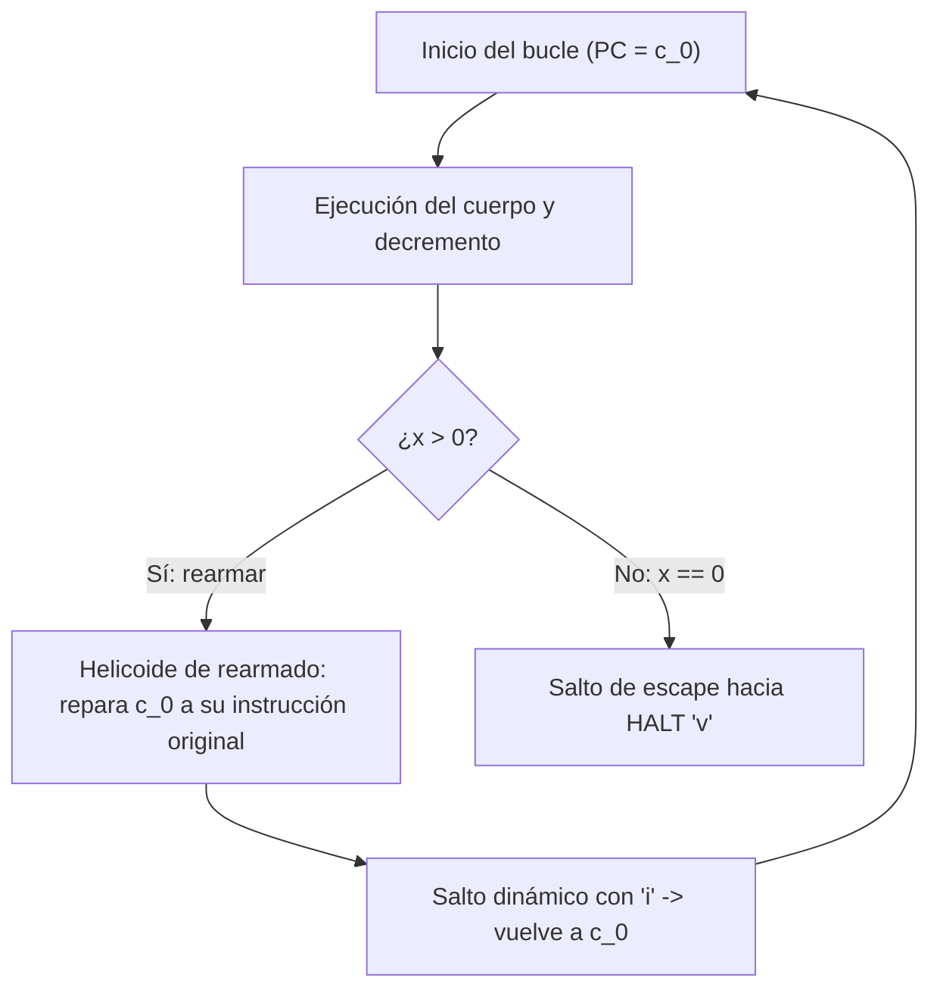

# Adversarial Boss Battles 1 a 4: La Frontera del Control de Flujo

Para someter a PureEpoch a las condiciones más adversariales concebibles —escenarios donde cualquier investigador en computación esotérica asumiría que Malbolge colapsaría irremisiblemente por automutación `XLAT2`— se diseñó y superó la serie de **Boss Battles 1 a 4**.

---

## Boss 1: Falla Bizantina en Cascada (Rollback del Rollback)

- **Desafío:** Corrupción forzada simultánea de la Época 1 y de la primera rutina de recuperación de la Época 2.
- **Solución Arquitectónica:** Doble salto en cascada $J_1 \to J_2$. Si el portal de Época 2 detecta un checksum de recuperación no válido, transfiere el control a un segundo nivel de Safe-Mode aislado topológicamente.
- **Artefactos:**
  * Binario canónico: `candidates/boss1_byzantine.mal` (29,540 bytes).
  * Metadatos: `candidates/boss1_byzantine.json`.
  * Generador: `tools/boss1_byzantine.py`.
  * Pruebas: `tests/test_boss1_byzantine.py` (8/8 PASS).

---

## Boss 2: Compilador de Brainfuck sin bucles a Malbolge

- **Desafío:** Demostrar que una secuencia arbitraria de operaciones lineales de Brainfuck (`+`, `-`, `>`, `<`, `,`, `.`) puede compilarse automáticamente a código ejecutable Classic Malbolge.
- **Solución Arquitectónica:** Traductor offline que asigna a cada celda de cinta una dirección toroidal y encadena instrucciones Malbolge con neutralización del cifrado `XLAT2`.
- **Artefactos:**
  * Generador/Compilador: `tools/boss2_brainfuck.py`.
  * Artefacto de muestra: `candidates/boss2_brainfuck.mal` (1,348 bytes).
  * Pruebas: `tests/test_boss2_brainfuck.py` (7/7 PASS).

> [!IMPORTANT]
> **Frontera Científica Honesta:** Este compilador cubre secuencias **sin bucles** (`[` y `]`). La tesis de que una VM completa de Turing en Malbolge puede ser emulada mediante este enfoque permanece catalogada como **`NOT_DEMONSTRATED`**.

---

## Boss 3: Bucle Autónomo `while x > 0` con PC Repetida

El bucle con reejecución de la misma dirección de memoria (`PC`) es el problema computacional más difícil en la historia de Malbolge, dado que la ejecución de una celda altera su contenido.



### 1. Falsación Histórica y Nemotron Audit
En iteraciones tempranas, la comunidad exploró "tablas de despacho desenrolladas" que simulaban repetición ejecutando celdas contiguas diferentes. El **Nemotron Audit** (`evidence/BOSS3_NEMOTRON_AUDIT.md`) demostró rigurosamente que una tabla desenrollada no constituye un bucle genérico (`[FALSADO / NOT_DEMONSTRATED]`).

### 2. Resolución Canónica: Ruta A (2026-11-07)
Bajo la estricta **Ruta A**, se diseñó y sintetizó un bucle genuino con **PC repetida en memoria de la VM**:
- Cada iteración decrementa un contador en memoria.
- Un módulo reparador (`rearm`) rota y recompone la instrucción original en la cabecera antes del salto de retorno.
- Al alcanzar cero, el evaluador de bifurcación salta limpiamente a la celda de parada `v`.

### 3. Artefactos y Mutantes Negativos
- **Binario canónico:** `candidates/boss3_real_loop.mal` (SHA-256 `9f48a4162ea4b523b16f2f99b2d57311ba6263ad64eb88d58a8997924b18ae08`).
- **Controles negativos:**
  * `candidates/boss3_real_loop_broken_decrement.mal`
  * `candidates/boss3_real_loop_broken_exit.mal`
  * `candidates/boss3_real_loop_broken_rearm.mal`
  * `candidates/boss3_real_loop_off_by_one.mal`
- **Pruebas:** `tests/test_boss3_real_loop.py` (12/12 PASS formal en 1.1s).

---

## Boss 4: Autómata Celular Wolfram Regla 90 (El Triángulo de Sierpiński)

La Regla 90 de Wolfram es un autómata celular elemental lineal donde el estado de cada celda evoluciona según la función XOR de sus vecinos:

$$c_i^{(t+1)} = c_{i-1}^{(t)} \oplus c_{i+1}^{(t)}$$

La evolución espacio-temporal genera el fractal del Triángulo de Sierpiński.

```text
               *
              * *
             *   *
            * * * *
           *       *
          * *     * *
         *   *   *   *
        * * * * * * * *
```

### Versiones y Frontera de Demostración:

1. **Boss 4 v1 (`candidates/boss4_sierpinski.mal`, 3,682 bytes):**
   Renderizador desenrollado en línea recta con portales invertibles de rotación mod 10 (`CELL_SPACE=37`, `CELL_NL=43`, `CELL_STAR=56`) y run-length encoding.
2. **Boss 4 Real / v2 (`candidates/boss4_real_ca.mal`, 28,154 bytes):**
   Despacho dinámico in-VM utilizando la función ternaria `crazy` como tabla de hashing para bifurcar a rutinas de emisión de patrones elementales.
3. **Boss 4 v3 (`candidates/boss4_v3_ca.mal`, 28,829 bytes, SHA-256 `d87635c24e757cb028efc0f4f971b869d80d282717084a9233088b22a57aa887`):**
   Motor de autómata celular genuino in-VM:
   - **Álgebra Booleana Ternaria In-VM:** Implementa $x \oplus y$ directamente en memoria combinando rotaciones `*` y operaciones `crazy`.
   - **Vector de Estado Activo:** 8 celdas activas con condición de frontera cíclica.
   - **Paridad bit-a-bit:** Verificado contra los 3 oráculos (Python Machine M0, C `mb_ref`, C Olmstead 1998) en `tests/test_boss4_v3_ca.py` (10/10 PASS).
