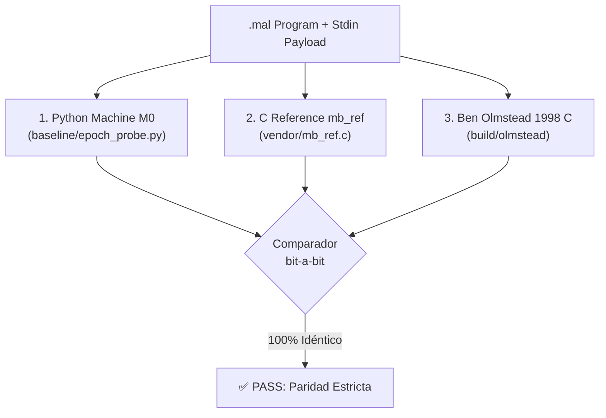

# Guía de Reproducibilidad y Oráculos de Verificación

Este documento describe el protocolo de verificación empírica, la triple paridad de oráculos y cómo ejecutar todas las pruebas y herramientas de CLI sin conexión a internet.

---

## 1. Requisitos del Entorno

- **Sistema Operativo:** Linux (Ubuntu 22.04 / 24.04 recomendado).
- **Python:** Versión **3.10+** (solo biblioteca estándar; cero dependencias de terceros en runtime).
- **Compilador C:** GCC / Clang con soporte C99 para compilar los oráculos de referencia.
- **Upstream Preservado:** Todo el código externo necesario está congelado en el directorio `vendor/`.

---

## 2. Los Tres Oráculos de Verificación

Para garantizar que ningún comportamiento observado sea un artefacto o bug de una implementación específica, cada programa se audita contra tres oráculos independientes:



1. **Python Machine M0 (`baseline/epoch_probe.py`):**
   Implementación formal instrumentada que registra el valor de cada registro ($A, C, D$), el opcode y los cambios de memoria paso a paso.
2. **C Reference `mb_ref`:**
   Implementación en C estricto basada en la especificación formal de Olmstead.
3. **Ben Olmstead Original 1998 (`build/olmstead`):**
   El ejecutable C nativo original creado por Ben Olmstead en 1998, compilado directamente sin modificaciones.

---

## 3. Ejecución de la Suite Completa de Pruebas

### Suite Global Completa del Repositorio (226/226 PASS)
```bash
python3 -m pytest tests/
```

### Suite de las 9 Utilidades Unix y Cronometría In-VM (123/123 PASS)
```bash
python3 -m unittest \
  tests/test_cat_real.py \
  tests/test_rev_real.py \
  tests/test_wc_real.py \
  tests/test_cmp_real.py \
  tests/test_add_real.py \
  tests/test_sort2_real.py \
  tests/test_reloj_real.py \
  tests/test_reloj_infinito.py \
  tests/test_reloj_carry.py
```

### Pruebas de Boss Battles 1 a 4 (41/41 PASS)
```bash
python3 -m unittest \
  tests/test_boss1_byzantine.py \
  tests/test_boss2_brainfuck.py \
  tests/test_boss3_real_loop.py \
  tests/test_boss4_v3_ca.py
```

### Pruebas del Ciclo Ouroboros (BolgePiton)
```bash
python3 -m unittest tests/test_ouroboros.py
```

---

## 4. Uso de las Utilidades CLI en Tuberías Unix

Cada utilidad cuenta con un CLI interactivo y compatible con tuberías Unix estándar mediante la bandera silenciosa `-q` (`--quiet`):

```bash
# Invertir cadena con Rev Real (Boss 6)
echo -n "HOLA" | python3 tools/rev_real_cli.py -q
# Salida: ALOH

# Sumar dos dígitos con Add Real (Boss 9)
echo -n "11" | python3 tools/add_real_cli.py -q
# Salida: 2

# Evaluar igualdad con Cmp Real (Boss 8)
echo -n "==" | python3 tools/cmp_real_cli.py -q
# Salida: =

# Ordenar dos elementos con Sort2 Real (Boss 10)
echo -n "10" | python3 tools/sort2_real_cli.py -q
# Salida: 01

# Cronómetro 4 ticks con Reloj Real (Boss 11)
echo -n "PPP" | python3 tools/reloj_real_cli.py -q

# Cronómetro 60 segundos con Reloj Infinito (Boss 12)
python3 tools/reloj_infinito_cli.py -q -n 4

# Acarreo temporal BCD in-VM 00:59 -> 01:00 con Reloj Carry (Boss 13)
python3 tools/reloj_carry_cli.py -q

# Inspección de telemetría de registros in-VM en vivo (Boss 13)
python3 tools/reloj_carry_cli.py --telemetry

# Composición en tubería Unix:
echo -n "21" | python3 tools/sort2_real_cli.py -q | python3 tools/rev_real_cli.py -q
# Salida: 21
```

---

## 5. Disciplina de Controles Negativos (Fail-Closed)

Cada utilidad y boss entrega tres variantes mutantes en `candidates/`:
1. `broken_drain`: Corrompe la instrucción de emisión (`<` reemplazada por NOP `o`), verificando que la salida no sea trivial.
2. `broken_eof`: Corrompe la instrucción de parada `v` en la detección de EOF, verificando que la terminación depende genuinamente de la condición de entrada.
3. `broken_loader`: Inyecta un carácter no permitido por el cargador estricto (`~`), verificando que el cargador rechaza el archivo inmediatamente.
